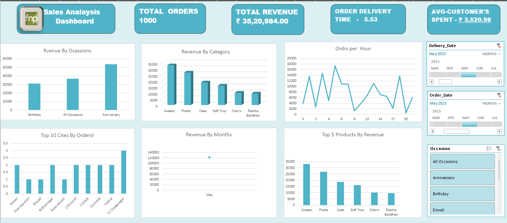

# FNP Sales Analysis Dashboard

I built this Excel dashboard to explore FNP sales data and understand how orders and revenue change across different occasions, product categories, cities, and hours of the day.

The main goal was to bring the important numbers and charts into one place so it's easier to see what's happening in the sales data without going through the entire dataset.

### Dashboard Preview

### What's included?

- Total orders, revenue, average delivery time, and average customer spending.
- Revenue comparison across occasions and product categories.
- Order distribution by hour.
- Top cities based on the number of orders.
- Monthly revenue and top-performing products.
- Filters for dates and occasions to explore different parts of the data.

### Tools I used

- Microsoft Excel
- PivotTables and PivotCharts
- Slicers and date filters

### What I learned

While building this dashboard, I got more practice with PivotTables, charts, and interactive filters in Excel. I also learned that choosing the right charts and keeping the layout simple makes it easier to understand the data.

This project gave me practical experience in working with sales data and presenting the results in a dashboard.

---

